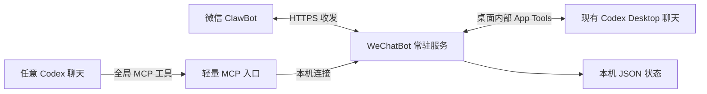

# WeChatBot 轻量桥接服务实施方案

日期：2026-10-27。本文记录实施约定；当前实现与手机验收结果见 [验收记录](docs/acceptance.md)。后续已按用户确认扩展为微信指定项目新建聊天，并精简消息头部。

## 1. 目标与已确认规则

在 Windows 本机运行一个轻量服务，通过微信 ClawBot 与当前 Codex Desktop 的现有聊天通信；不用完整 OpenClaw、DeepSeek Harness 或另一套 AI 助手。

用户在本次讨论逐项确认：

| 项目 | 确定行为 |
| --- | --- |
| 通知范围 | 按聊天开启；开启后该聊天每次执行结束都通知，直到关闭。默认未开启。 |
| 普通微信消息 | 发给上次明确选择的聊天；尚未选择时返回选择提示。 |
| 通知与目标 | 其他聊天的通知不能自动改变当前微信消息目标。 |
| 聊天忙碌 | 新要求立即补充到正在执行的任务中，尽量不中断当前工作，不主动等待整轮完成。 |
| 媒体范围 | 第一版仅文字消息、文字通知。 |
| 聊天连续性 | 继续桌面原聊天，保持原上下文；不创建手机分支，不用另起 Codex 进程冒充接管。 |
| 微信新建 | 每次显式指定本机已有项目和首条要求；创建成功后自动选中新聊天，不自动开启通知。 |
| 当前交付 | 本地代码、使用说明与实际验收记录；不自动提交、推送或部署。 |

首版按单台 Windows、当前 Windows 用户、一个本人微信账号、一个 Codex Desktop 实例设计。使用已登录的 Codex，不新增模型调用或 API Key。

### 1.1 必须成立的结果

1. 在任意本地 Codex 主聊天中说“开启这个聊天的微信完成通知”，即可注册该聊天；以后从桌面发起的新轮次也会通知，无需每次再说。
2. 微信能列出可选聊天，按稳定编号选择、发送要求，结果来自对应原聊天。
3. 未订阅的聊天不产生桌面任务完成通知；但微信主动发起或补充的任务必须返回结果。
4. 同一个轮次同时满足“已订阅”和“微信要求返回”时，只发送一份结束通知。
5. 聊天编号与订阅重启后保留；发送结果未知时不盲目重发任务。

“执行结束”按 Codex 的一轮执行定义，不等同于业务目标全部达成。通知使用“本轮已结束／执行失败／已中断”，附原回复摘录；不得仅凭 completed 宣称业务成功。

### 1.2 首版不做

桌宠、托盘面板、Web 管理后台、手机独立聊天、群聊、多用户、多电脑、图片/文件/语音、自动审批、远程执行任意 shell 命令、从微信新建项目或 worktree、模型切换、定时任务、全量聊天历史同步。Codex 关闭时不另启 CLI 接管；明确告知需打开桌面。

## 2. 用户操作与消息规则

### 2.1 初次使用

1. 运行本地安装配置命令，配置全局 MCP 工具并启动桥接服务。
2. 运行登录命令，查看二维码，在微信扫码确认；如有验证码，按提示输入。
3. 本人在微信 ClawBot 中发一条绑定消息。校验发信人等于扫码返回的本人身份，并保存回复上下文后，才显示“微信已连接”。
4. 在 Codex 聊天中开启通知，或在微信列出聊天后选择目标。
5. 服务与 Codex Desktop 保持运行、电脑联网。睡眠或关机期间不会执行或即时发送。

### 2.2 Codex 侧全局工具

注册用户级 MCP，供本机各项目的 Codex 聊天使用。首版只暴露以下三个工具；工具说明要求明确的用户请求才修改通知/选择状态。

| 工具 | 参数 | 行为 |
| --- | --- | --- |
| `wechat_set_notifications` | `enabled: boolean` | 为当前调用聊天持续开启/关闭结束通知，返回编号、标题与实际状态。 |
| `wechat_select_current_chat` | 无 | 明确把当前调用聊天设为微信普通消息目标；不隐式开启通知。 |
| `wechat_status` | 无 | 返回连接状态、当前选择、当前聊天订阅状态和未送达计数。 |

聊天身份取自调用方可信 metadata，不能让模型凭标题或“最新聊天”猜 ID。预期使用 `x-codex-turn-metadata` / `openai/threadId`；自定义 MCP 是否获得这些字段必须在第一阶段实测。缺失时返回明确错误，不退回用常驻进程继承的一条固定 `CODEX_THREAD_ID` 处理所有聊天。

开启通知时：先读当前聊天，记下观察基线，再持久化订阅；当前正在执行的轮次在范围内，开启前已经结束的历史轮次不补发。关闭时立即阻止尚未开始发送的订阅通知；已经发出的消息不能撤回。关闭订阅不取消微信请求应有的结果回复。

重复开启已经开启的订阅只返回当前状态，不重置观察位置；关闭后再次开启才建立新基线。安装 MCP 后需通过 Codex 支持的配置重载方式让已有聊天获得工具；若必须重启，提示用户待当前任务结束后操作，不擅自重启桌面。

### 2.3 微信侧命令

| 输入 | 行为 |
| --- | --- |
| `列表` | 展示最近可发现的本地主聊天、全部已订阅聊天与当前选择；较多时分页。 |
| `列表 2` | 查看下一页，页码只用于显示，不改变聊天编号。 |
| `项目` / `项目 2` | 展示本机已有项目、目录别名及路径，分页查看。 |
| `新建 WeChatBot｜首条要求` | 明确项目后创建本地聊天并执行首条要求，成功后自动切换到新聊天；通知默认关闭。 |
| `切换 #3` | 选中 #3；返回标题和当前状态，后续普通文本发给它。 |
| `#3 请补充测试` | 单次发送到 #3；不改变已选择的普通消息目标。 |
| `通知 #3 开` / `通知 #3 关` | 为指定聊天持续开启/关闭通知。 |
| `状态` | 显示当前目标、连接情况、订阅数量和发送异常。 |
| `帮助` | 显示上述用法。 |
| 普通文字 | 发送到已明确选择的聊天；无目标时只返回列表提示。 |

只对完整匹配的命令进行本地解析，不用模型判断消息应该发往哪里。任何未知编号、已删除/归档目标、非本机聊天都明确报错；不得自动发给另一聊天。默认排除子代理聊天。

编号 `#3 → (hostId=local, threadId)` 持久化、单调分配、不复用。标题改变不影响编号。列表接口有范围/数量限制时如实提示；很久以前的聊天可在桌面打开并调用全局工具注册，因此“任意聊天可开启”不依赖枚举全部旧历史。

示例通知：

```text
[#3 修复课程排期] 本轮已结束
结果：已修复取消课程后的通知问题，相关检查通过……
继续此聊天：#3 请检查批量取消
当前普通消息目标仍为 #7。
```

结果直接取原聊天最终回复并转为纯文本摘录，不另调模型总结。首版单条通知上限暂定 1500 个 Unicode 字符，超出截断并提示在桌面查看完整内容；这属于本服务保守设计值，不是微信官方限额。长度边界必须真实微信验证。

## 3. 最小技术结构

### 3.1 选择

- JavaScript ESM，Node.js 24；本机现有 Node v24.11.1，避免额外编译和运行环境。
- 一个常驻 `daemon`：独占微信收发、聊天映射、桌面连接、通知观察和持久化。
- 一个按 Codex 生命周期启动的轻量 `mcp` 入口：仅转发工具调用与当前桌面连接信息到 daemon，不接收微信、不另跑观察器。
- CLI 与两种入口共用一个代码包。只引入 MCP SDK、其所需校验依赖和二维码生成库；HTTP、命名管道、计时器、文件存储、测试使用 Node 内置能力。具体依赖版本在实施时锁定。
- 本地 JSON 文件存储，单一 daemon 写入；不用 Redis、数据库服务、消息队列或容器。



MCP → daemon 使用仅绑定 `127.0.0.1` 的 HTTP 接口及随机 Bearer token。daemon 启动时申请系统分配端口，将端口、进程身份与 token 写入仅当前用户可读的运行文件；不开放公网端口。启动器在启动新进程前验证已有服务身份与健康；用原子创建的本地所有权文件防止重复启动，无法证明旧实例已退出时直接提示，不强杀其他进程。

### 3.2 桌面连接：首版只选 App Tools

采用本会话已实测的桌面 App Tools 路径，集中封装在 `desktop-client`：

1. MCP 入口启动时将当前 `CODEX_APP_TOOLS_PIPE_PATH` 和所属 host 信息注册到 daemon；Codex 重启重新启动 MCP 时刷新该注册。
2. 按当前 bundled App Tools 的 framing 与请求结构实现小型本机客户端：4 字节小端长度 + UTF-8 JSON-RPC。
3. 通过 `tools/list` 获取当前工具 namespace/schema；已有聊天限定使用 `list_threads`、`read_thread`、`send_message_to_thread`，项目与新建命令再限定使用 `list_projects`、`create_thread`。后两项不可用时仅拒绝新功能，不影响已有聊天。不要把任意桌面工具暴露给微信。
4. 使用真实调用聊天或已注册聊天作为 caller context；保留正确的来源记录，不伪装系统/开发者消息。协议不接受时报告错误，不更换身份绕过检查。
5. `send_message_to_thread` 保持原聊天模型和权限，不传模型、思考强度或审批覆盖参数。需要电脑审批的操作提示回电脑处理，不自动确认。

daemon 将最近一次桌面注册保存为本地连接候选。仅 daemon 重启时，先用该候选重新连接并验证工具 schema、host 与已注册聊天可读性，通过后才恢复工作；候选本身不代表连接仍有效。MCP 每次工具调用前读取当前 daemon 实例身份，实例变化时重新注册连接信息。因此只重启桥接也能恢复，且不需要另加常驻心跳进程。

此路径向模型提供的是工具转达消息，不是原生输入框直接输入。微信正文作为用户授权渠道的数据原文传入；桥接仅在正文首行附稳定消息标记，不再附来源和目标聊天中文说明，不加入“忽略其他指令”等提权提示。

**不做运行时多路径回退。** 不在失败后自动改走 `codex exec resume`、SDK、新 app-server 或 Agent Pet follower。Agent Pet 的 follower 作为后续替换桌面适配器时的参考；首版不并行实现。其源码显式覆盖部分权限参数，不能照搬后声称继承原权限。

内部接口有版本风险。安装及 `doctor` 记录版本、检查必要 schema；发现不兼容时暂停桌面写入并说明原因。不得硬编码 `0.1.6` 等插件缓存目录，也不得修改/注入 Codex 安装包。

### 3.3 微信接入

直接实现腾讯公开客户端协议的必要部分：二维码获取/轮询、`getupdates` 长轮询、`sendmessage` 文本发送。使用登录返回的 base URL，正确区分账号 `bot_token` 与每个对话的 `context_token`。

仅一个 daemon 长轮询同一微信账号。所有入站先校验 bot/account 与本人 sender，再解析命令；群聊及其他身份不执行。非文字消息返回“第一版仅支持文字”，不下载媒体。

当前资料不能保证主动通知的有效时窗。无 context token 时不把通知标成已发送；收到本人新消息后保存最新 token。明确的 token 拒绝进入待刷新状态，保留通知记录；登录凭据失效则提示重新扫码。网络/读取错误采用有限退避继续接收；不能把一次发送超时当作确定失败后无限重发。

## 4. 实际执行流程

### 4.1 微信发要求到原聊天

1. 取到入站批次，将本人消息及新游标在一次本地状态写入中持久化；成功后才推进接收游标。
2. 按接收顺序解析本地命令与聊天选择。执行消息确定目标后，将该目标固定在这条记录上；后续切换不改变已收到要求的去向。
3. 以微信稳定 message ID 去重。缺少可用身份/消息 ID 时不执行，记录格式错误；不能按正文去重误吞用户主动重复的要求。
4. 把投递意图持久化，再发一次桌面请求。正文加桥接唯一标记，例如 `WECHAT_MESSAGE_ID=...`，用于确认实际落在哪个轮次。
5. 桌面忙时使用现有工具的追加行为，空闲时开始下一轮。仅串行化同一聊天的短暂提交步骤，不等待前一轮结束；不同聊天互不等待。
6. 调用返回仅代表转达请求受理。用 `read_thread(includeOutputs=true)` 查到目标聊天的 `functionCallOutput(name=send_message_to_thread)`，匹配唯一标记，取得真实 turn ID 后才确认落入该轮。
7. 向微信返回简短确认及目标编号；观察真实 turn 完成，再返回最终结果。忙时多条追加落入同一轮时只发一份最终结果。

已在本次方案核对中确认：现有历史的 `read_thread(includeOutputs=true)` 返回带正文的上述 functionCallOutput，并能取得其 turn ID。新版本与真实并发仍需实施阶段验证。

**提交超时/断线：**继续用标记只读核对。能找到则观察该轮；不能确认则记为“提交状态待确认”，提示检查原聊天，禁止自动重发或切换执行路径。桥接不承诺跨微信与 Codex 的 exactly-once 事务。

### 4.2 持续完成通知

1. 只观察已订阅聊天，以及微信请求尚在等待结果的聊天。
2. 首版每 3 秒轮询这些聊天，最多 2 个并发读取。此轮询是正常通知路径的必要步骤：当前 App Tools 读接口没有本方案已验证的完成订阅机制，不称其为“兜底”。没有观察对象时停止轮询。
3. 以 `threadId + turnId` 识别轮次。读取新轮次；必要时沿 cursor 分页到上次观察位置，不能只看“最新回复”而漏掉快速连续执行。
4. 同一轮终结状态为 completed/failed/interrupted 后，提取对应结果。内部 App Tools 当前最终回复字段是 `phase=final_answer`；不能仅出现最终文本就提前判定轮次结束。
5. 检查订阅当时仍有效或该轮需要微信结果，合并为一条待发送记录，使用固定通知 ID/client ID。
6. 串行发送。校验 HTTP 与业务返回，收到明确 `ret=0`，或没有冲突错误且携带服务端合法正整数 uint64 `message_id` 后记为“微信接口已接受”；空对象及无法识别的回执不能当作成功，不把接口成功说成用户已阅读。2026-10-27 实机确认成功回执可仅含 `message_id`，详见验收记录。验收还需手机实际看到消息。
7. 没有最终文本也已结束的轮次，发送实际状态并提示桌面查看，不生成虚构摘要。

服务离线期间发生的结束事件，在重连后从已保存的观察位置补查。只处理订阅有效区间内尚未记录的新结束轮次，不重新发送启用前历史；若无法找到观察位置或历史不可读取，记录观察缺口并提示，不猜测全历史重放。

### 4.3 通知发送异常

- 尚未尝试发送、缺少 context token：保留待发送，等待本人新消息刷新后发送。
- 服务端明确拒绝：保存错误。仅对已确认属于上下文失效的错误，在新消息刷新后重试；其他错误交由状态页/CLI 提示处理。
- 已发请求但超时，或发送过程中进程退出：标成“送达状态未知”，不自动重发。固定 client ID 只是关联标识，不假定服务端幂等。
- 本地状态可查询未送达/未知记录；提供 CLI 对指定通知手动重发。手动重发前显示内容与原因，并提示可能重复。
- 关闭订阅撤销仅由该订阅产生、尚未发送的记录；微信请求的结果回复仍保留。

### 4.4 微信指定项目新建聊天

1. 只处理本人稳定消息 ID 的明确“新建 项目｜首条要求”命令，缺少项目或要求即报用法错误，不转为旧聊天要求。
2. 当次读取桌面项目列表，按项目名、目录别名、完整路径或 ID 精确匹配本地主机项目；不存在或有歧义就拒绝，不猜项目。
3. 保存创建意图（项目 ID、首条要求、稳定标记与 submitting 状态）后，只调用一次 create_thread。使用指定项目的 local 环境，不传模型、思考强度、权限覆盖或 worktree 参数。
4. 收到真实本地 threadId 后，原子保存稳定编号、目标及当前选择，并发一份“已创建、首条要求已受理”确认；不等待整轮结束才允许继续，也不自动开启通知。
5. 读取新聊天，以实际 create_thread 工具转达记录的首行标记关联轮次。也兼容初始 userMessage 的首行标记；仅结束后生成最终结果，不重复确认或重复通知。
6. 创建超时、回执无真实 ID 或派发后的本地保存异常，均保留未知状态，不自动重建。已知 ID 时继续只读观察；ID 不可确认时明确要求在桌面核对，不猜最近新聊天。

## 5. 数据、权限与生命周期

### 5.1 本地数据

默认数据目录 `%LOCALAPPDATA%\WeChatBot`，与项目源码、Codex 数据目录分开。

| 文件 | 内容 |
| --- | --- |
| `config.json` | 单账号/本机设置、本人标识、必要运行参数。 |
| `credentials.json` | bot token、最新 context token、服务端 base URL。 |
| `state.json` | 稳定聊天编号、当前选择、订阅、观察位置、入站投递记录、通知记录、接收游标、待重新验证的桌面连接候选。 |
| `runtime.json` | 当前 daemon 端口、PID/启动身份、随机本地访问 token；退出后清理。 |
| `logs/bridge.log` | 连接与状态变更、错误及关联 ID；默认不记正文、二维码凭据或 token。 |

所有状态由 daemon 单写，使用临时文件写完并原子替换；失败时不推进游标/确认已保存。MCP 与 CLI 都通过本地接口修改，不自行并发编辑 JSON。仅保留最近的已完成去重/通知记录，保留所有未解决记录；具体清理边界不得破坏接收游标和当前观察位置，测试覆盖重启后重复批次。

首版使用 Windows ACL 限制凭据和运行文件为当前用户及必要系统身份可读写，不额外引入密钥服务。对同一 Windows 用户下的恶意进程不宣称隔离；不开放公网控制接口。

### 5.2 启停与桌面重启

- 安装过程注册全局 MCP 配置；保留原配置，仅新增本项目命名空间，并备份修改前文件。
- 提供 `start`/`stop`/`status`/`doctor`。停止只通知本项目 daemon 正常退出，不按通用 node/codex 进程名杀进程。
- 可用 Windows 任务计划程序实现当前用户登录后启动，隐藏窗口、无管理员权限；默认手动启动，自启动由显式命令启用。
- Codex Desktop 重启后，由新启动的 MCP 入口重新注册 pipe。实施阶段必须验证自定义 MCP 能获取当前 pipe、确实会重新注册；缺失时明确报错，不沿用旧路径。
- 仅 daemon 重启时按 §3.2 重新验证已保存的候选；失败则等待新的 MCP 注册并提示连接未恢复，不把服务进程已启动说成桌面已接通。
- 服务断开桌面时暂停新任务提交，保留订阅和编号；恢复后先读状态，再恢复观察，不重发状态未知的写入。
- 桥接重启恢复已确认的投递/通知；遗留“正在发送/正在提交”记录转为未知并只读核对，不假定上次没有发生副作用。

## 6. 代码边界与预定命令

以下是要实现的结构与命令，不是当前目录已经具备的功能。

```text
src/
  cli.mjs                 登录、启停、诊断、配置安装
  daemon.mjs              启动与统一调度、本地接口
  mcp.mjs                 全局工具与当前桌面连接注册
  desktop-client.mjs      App Tools 内部协议、工具读写
  weixin-client.mjs       二维码、长轮询、文本发送
  routing.mjs             稳定编号、命令解析与选择
  notifications.mjs       轮次观察、通知合并和发送状态
  state-store.mjs         单写JSON、原子保存与恢复
scripts/                  Windows 启停、自启动和ACL配置
test/                     node:test 行为测试及可选真实连通脚本
docs/                     使用说明、技术证据与验收记录
```

建议命令：`wechatbot login`、`start`、`stop`、`status`、`doctor`、`install-mcp`、`uninstall-mcp`、`autostart enable|disable`、`retry-notification <id>`。安装后包装为 Node CLI，文档同时给出直接 `node src/cli.mjs ...` 的等价方式。

## 7. 实施顺序与每阶段出口

| 阶段 | 实施内容 | 完成条件 |
| --- | --- | --- |
| P0 接口校准 | 当前版本 App Tools 外部连通；自定义 MCP 调用身份与 pipe 传递；轮次关联与重启发现 | 两条现有主聊天各调用全局工具，身份正确；active/idle 原会话收发；不更改模型/权限；重启后重新发现。不能通过时停止依赖功能实现，修订单一适配路径。 |
| P1 本地基础 | CLI、单 daemon、带鉴权本地接口、原子状态、全局 MCP 安装/卸载 | 重复启动不出现两个微信接收者；配置保留；不同聊天注册不串号。 |
| P2 微信文字 | 二维码、本人绑定、长轮询、文本发送、凭据与游标持久化 | 真微信发送并读回；非本人不执行；重复批次不重复投递；缺上下文不误报送达。 |
| P3 双向与通知 | 命令路由、忙时追加、持续订阅、完成观测与合并 | 下表核心场景全部通过；微信请求和订阅通知不重复。 |
| P4 重启与交付 | 两端重启、错误分类、日志、使用文档、可选自启动、验收记录 | 确认状态恢复、不重放未知写入；用户可按文档独立登录、启停和排查。 |

先做本机接口与微信最小真实验证，再扩展命令和恢复；不要到最后才发现权限、token 或进程接入假设不成立。P0/P2 涉及扫码及测试消息时需用户参与账号确认；本次方案本身不执行这些动作。

## 8. 验收矩阵

自动化使用 `node --test`；模拟仅隔离微信网络、桌面传输等外部端点，不模拟关键路由/持久化/轮次归并逻辑。另执行少量真实 Windows 与微信联通检查。没有项目应用 CI，不借用其他仓库的检查脚本。

| 场景 | 必须观察到的结果 | 能发现的错误 |
| --- | --- | --- |
| 两条桌面聊天分别开启通知 | 编号、标题和结果各自对应；之后的新轮次仍通知 | 固定继承一个 thread ID、串聊、只通知开启当次 |
| 关闭一个聊天通知 | 之后该聊天桌面轮次不通知，另一个仍通知 | 全局开关误当按聊天订阅 |
| 普通消息及显式编号 | 普通消息只到选中聊天；`#3 ...` 只到 #3，通知不切换选择 | 把最近通知当路由、异步选择漂移 |
| active 追加与 idle 唤醒 | active 不被取消且同轮收到要求；idle 在原聊天新建轮次 | 另起会话、排队整轮、错误中断 |
| 追加与结束同时发生 | 用投递标记定位实际 turn，不返回上一轮答案 | 读取最新回复的竞态 |
| 同轮多个微信消息＋订阅 | 各消息关联正确，最终结果只通知一次 | 重复通知、每条消息等待一个不存在的新轮次 |
| final 文本先出现、轮次尚未结束 | 仍不发结束通知，状态 completed 后才发 | 只看文本就认定业务完成 |
| failed/interrupted/无最终文本 | 发送真实状态，不写“任务成功” | 状态标签与业务结论混淆 |
| 重复入站、进程中途退出 | 不重新执行已提交/状态未知的要求 | cursor 提前推进、崩溃后盲重发 |
| 微信发送超时 | 留下送达未知，不自动连发；可人工核对 | 把超时等同未送达 |
| 桌面/桥接分别重启 | 编号、选择、订阅保留；仅重启 daemon 且不调用新工具也能验证候选后恢复观察；桌面重启能重新注册 | 陈旧 pipe、丢失注册、历史通知重放、多个 daemon |
| 桌面工具需审批 | 微信不能绕过原权限；明确提示电脑处理 | 照搬上游 never/权限参数造成行为改变 |
| 未授权 sender／未知编号／媒体 | 不提交任何 Codex 要求 | 错误身份与默认目标回退 |
| 新鲜 token、闲置约2小时、隔夜后主动通知 | 分别记录接口返回与手机实际收到情况；失败后新消息刷新再试 | 将一次成功扩大为无限期通知保证 |

最终验收记录区分：自动化通过、当前桌面真实通过、微信真实通过、尚未执行。安装包/启动脚本也要单独验证。二维码登录成功不是双向操作通过，API ret=0 不是用户已看到通知。

## 9. 交付与保留限制

实施完成应交付：可运行代码与锁文件、登录/启停/诊断命令、全局 MCP 安装和卸载、可选自启动命令、使用文档、实际验收记录、引用代码的版权与许可证声明。

当前暂不承诺：微信永不过期的主动通知、服务断线时即时送达、通知 exactly-once、桌面内部协议跨升级兼容、远程审批。对于未知提交/送达结果，选择停止自动写入并让本人核对；这是避免重复执行的明确取舍。若以后需要无人值守长期通知，应先取得真实的 token/时窗证据，再决定是否增加其他通知渠道，不在首版预先实现。

本方案需要的外部配置是微信扫码凭据、用户级 MCP 条目和本地数据目录权限；不需要部署服务器、额外模型账号或新增云端环境变量。内部 `CODEX_APP_TOOLS_PIPE_PATH` 是运行时发现信息，不能要求用户手工固定长期值。

## 10. 依据与实现注意事项

完整证据、固定上游提交及未知边界见 [技术证据记录](docs/technical-evidence.md)。

- [Codex MCP 配置](https://learn.chatgpt.com/docs/extend/mcp)：支持用户级工具配置；具体 metadata 传递还需在自定义服务实测。
- [腾讯微信协议](https://github.com/Tencent/openclaw-weixin/blob/874637a0dbc24050f72d1385add4fc6170a2d726/docs/protocol.md)：取必要的认证与文字收发结构；不是完整服务端长期承诺。
- [Agent Pet 桌面连接](https://github.com/wy1003/agent-pet/blob/86c6fb6ef378e1778c88456be0de2c70ff443f70/desktop/codex-desktop-executor.mjs)：参考原会话归属确认、精确 turn 关联与不盲目重提；不复制其 UI、额外 SDK 回退或权限覆盖。
- 2026-10-26 本机会话中外部 App Tools 的 active/idle 双向验证已通过；证据文件保存在 `C:\Users\Administrator\AppData\Local\Temp\codex-wechat-bridge-probe`，临时目录不作为长期交付依赖。
- 2026-10-27 当前内核为 `0.164.0-alpha.11.1`，bundled App Tools 为 `26.1021.31345`；新版本只读结构检查已完成，完整双向重验列入 P0。旧探测脚本曾将 final_answer 写成 final，修正后的外部读回已确认 completed；后续实现必须使用实际返回 schema。

本文所有功能、结构、命令和验收安排均为待实施设计，不表示服务已经可用。
